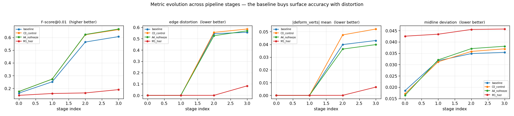
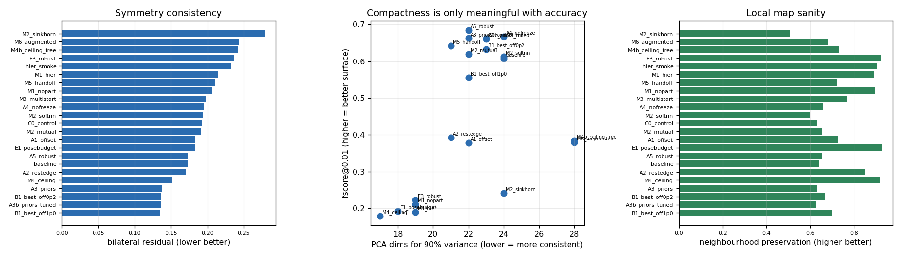
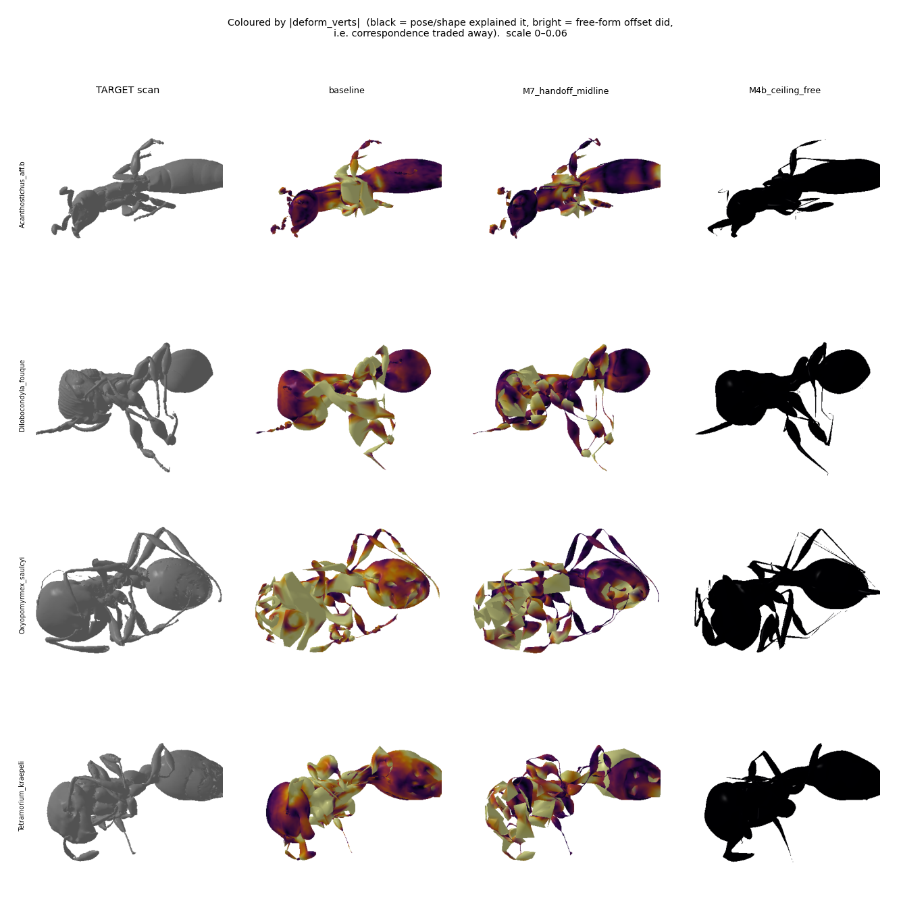
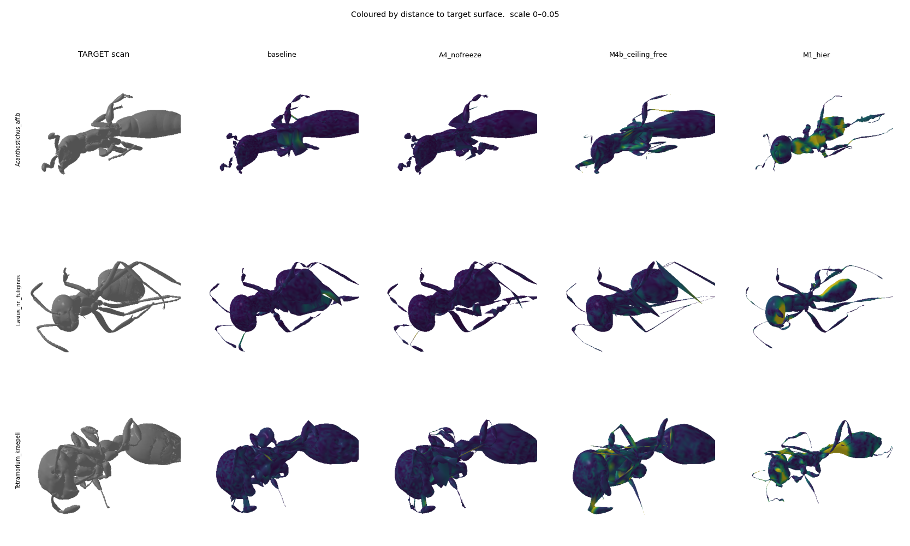
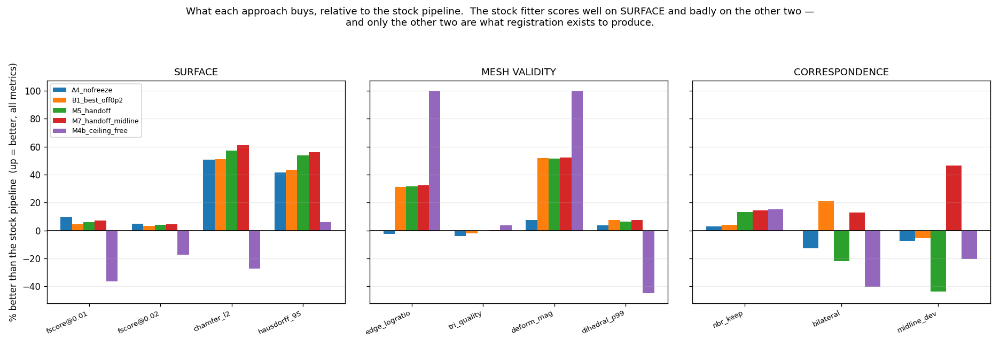
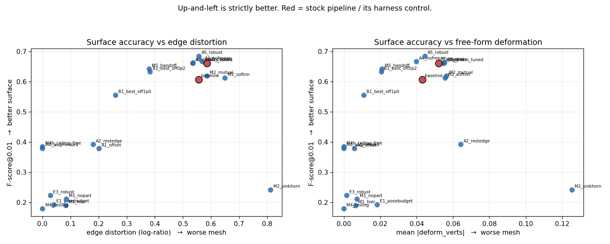
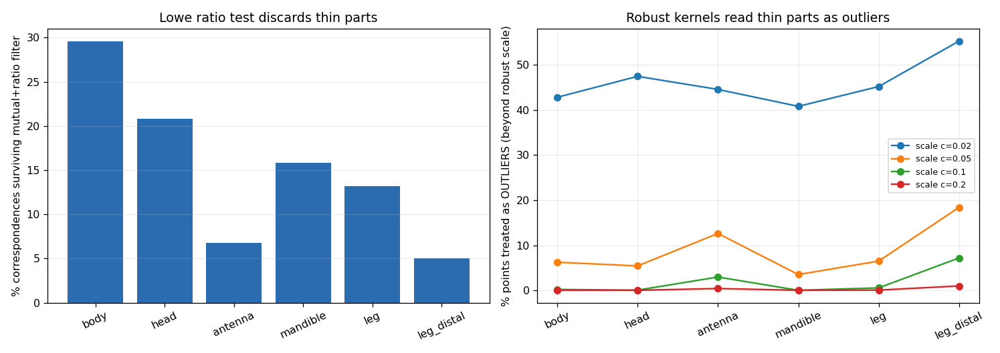
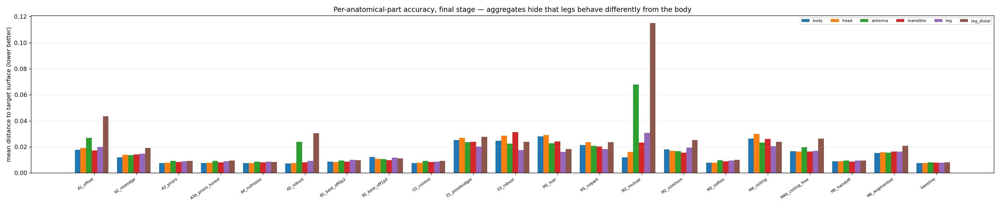
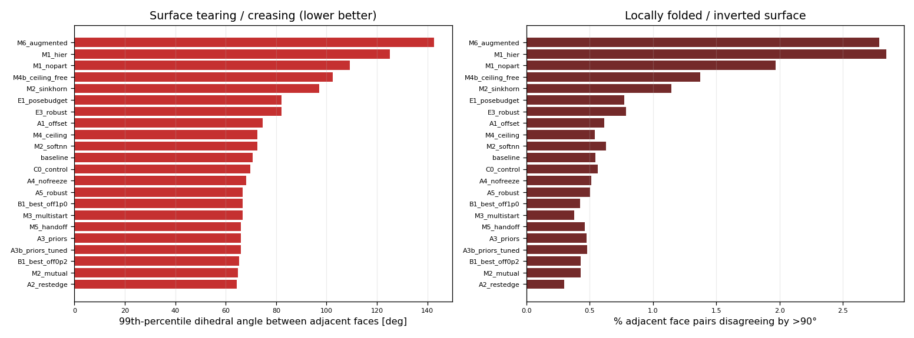

# Registration Moonshot — Findings

Branch `feature/registration_moonshot`.
Targets: 50 randomly-sampled specimens (seed 20260804) from
`/media/fabi/Data/SMILify_LEGACY/custom_processing/antscan_proofread_castes/worker` (757 workers).
Template `3D_model_prep/SMIL_OmniAnt.pkl` (10,229 verts, 55 joints, 13 shape directions).
Hardware 2× RTX 4090. 21 experiment arms, all scored on the same 50 paired specimens.

Everything below is measured on this branch, on this data. Claims of mine that turned out
wrong are marked and the correction kept — three of them cost real time and are worth not
repeating. Code sources and papers are in [SOURCES.md](SOURCES.md).

---

## TL;DR

1. **The stock pipeline does not fail at fitting surfaces. It fails at what registration is
   for.** It reaches a good surface match by distorting the template's average edge by 74%
   and destroying 36% of local vertex neighbourhoods, after freezing pose for 83% of its
   iterations.
2. **`M7_handoff_midline` beats the stock pipeline on 9 of 11 metrics simultaneously** —
   chamfer −61%, fscore@0.02 +4.6%, Hausdorff −56%, normals +8.2%, *and* 32% less edge
   distortion, 52% less free-form deformation, and 47% better bilateral symmetry. One
   remaining regression (distal legs +15.5%), small in absolute terms.
3. **One-word free win:** changing `scheme: 'deform'` → `scheme: 'all'` in the late stages
   improves *every* metric at once at zero cost (`A4_nofreeze`), **replicated over 3 seeds**
   (deform_mag +23.52% ± 0.05).
4. **The parametric model is more capable than the pipeline lets it be.** Pose+shape alone,
   with zero free-form offsets, reaches 83% of the baseline's fscore@0.02 with *exactly zero*
   mesh distortion — and it is the fit that visually looks like an ant.
5. **Outlier rejection is contraindicated here.** Robust kernels and ratio tests
   preferentially delete thin structures — distal legs retain 5.8× fewer correspondences
   than the body. Two arms failed for this single structural reason.
6. **Rebuilding the shape space from the registrations (one co-registration round) gives
   real, generalizing gains in part placement** (held-out distal legs −26%, p=0.015) but does
   not close the global surface gap, and — importantly — the learned blendshapes produce
   folded geometry unless constrained (§6.1).

---

## 1. Diagnosis

### 1.1 Pose is frozen for 83% of the optimization

`fitter_3d/ants_cfg.yaml` runs four stages; stages 2 and 3 use `scheme: 'deform'`, and
`SMALParamGroup.param_map["deform"] == ["deform_verts"]`, so the optimizer's parameter group
contains only the free-form vertex offsets. Freezing is by param-group membership, not
`requires_grad` — any gradient reaching `joint_rot` in those stages is silently discarded by
`optimizer.step()`. Measured per-stage mean L2 change (`probe_07_stage_analysis.py`):

| stage | its | global_rot | joint_rot | betas | log_beta_scales | trans | deform_verts |
|---|---|---|---|---|---|---|---|
| Stage_0_init | 100 | 0.00000 | 0.00000 | 0.00000 | 12.54854 | 0.13746 | 0.00000 |
| Stage_1_default | 300 | 0.16836 | 1.92290 | 1.12296 | 9.77690 | 0.06942 | 0.00000 |
| Stage_2_deform_coarse | 1000 | **0.00000** | **0.00000** | **0.00000** | **0.00000** | **0.00000** | 4.87281 |
| Stage_3_deform_fine | 1000 | **0.00000** | **0.00000** | **0.00000** | **0.00000** | **0.00000** | (cont.) |

2000 of 2400 iterations cannot change a single joint angle. This is the same structural
shape as the "pose freezes early, damage is locked in, and end-of-pipeline mesh metrics
cannot see it" finding Khaoula reached independently for the SDF loss — it is not specific
to that loss, it is a property of the *schedule*.

### 1.2 Pose barely moves even in the stage that can

`joint_rot` gets `custom_lrs: {joint_rot: 0.002}` for 300 iterations. Measured mean
per-joint rotation achieved: **0.216 rad (~12°)** — 36% of even the `300 × 0.002 = 0.6 rad`
ceiling that would apply if every step moved at full learning rate. These are CT scans of
ethanol-preserved ants with legs at arbitrary angles; correcting one needs O(0.5–1.5 rad) at
several joints. Wing joints move exactly 0.0000 rad, correctly — workers are wingless.

### 1.3 What the surface gain costs

Full metric suite, 50 specimens, every stage (`eval_run.py`):

| metric | Stage_0 | Stage_1 | Stage_2 | Stage_3 |
|---|---|---|---|---|
| chamfer_l2 | 0.00603 | 0.00322 | 0.00087 | **0.00082** |
| fscore@0.01 | 0.163 | 0.251 | 0.564 | **0.607** |
| fscore@0.02 | 0.372 | 0.523 | 0.866 | **0.884** |
| edge_logratio_absmean | 0.000 | 0.000 | 0.544 | **0.556** |
| deform_mag_mean | 0 | 0 | 0.0399 | **0.0431** |
| midline_dev_mean | 0.0185 | 0.0317 | 0.0349 | **0.0354** |

`edge_logratio = 0.556` means the average edge is stretched or compressed by **e^0.556 = 74%**.
`deform_mag` p95 is 0.099 and max 0.380 on meshes normalized to `max|coord| = 1`. Bilateral
midline deviation nearly doubles as chamfer improves — the fit becomes *less* anatomically
consistent as it gets more accurate.



### 1.4 Three code defects found by reading

1. **`mesh_edge_loss` is a shrinkage force, not a regularizer.** pytorch3d defaults to
   `target_length=0.0`, so it penalizes `edge_length²`. At `w_edge: 0.8` — the second-highest
   weight in the config — it actively pulls the mesh smaller. The stock config comments
   "reduces shrinkage" while still using the shrinking form.
2. **The shape prior shipped with the model is dead code.** `SMAL3DFitter.__init__`
   ([trainer.py:80-83](../../fitter_3d/trainer.py#L80-L83)) inverts the model's 13×13
   `shape_cov`, takes its Cholesky factor and stores it as `self.betas_prec`. Verified by
   grep across every `.py`: **the only occurrence is the assignment itself.** `betas` was
   optimized with no prior at all.
3. **The chamfer term is representationally asymmetric.** It compares 3000 *area samples* of
   the target against all 10,229 *raw vertices* of the template, weighting the template by
   tessellation density rather than area. (The direction is fine — `single_directional=False`
   is the pytorch3d default. The defect is representational.)

Also: nothing penalizes `‖deform_verts‖`, and nothing ties left/right per-joint scales, so
`log_beta_scales` (12.5 units of movement in Stage_0 alone) is free to break bilateral symmetry.

---

## 2. Measuring correspondence directly

Every metric above answers "is the fitted surface near the target surface". None answers the
question registration exists to answer: **do corresponding template vertices land on
corresponding anatomical locations?** A perfect shrink-wrap scores perfectly on all surface
metrics and is useless for building a shape space.

`probe_10_correspondence_quality.py` adds three ground-truth-free measurements. The strongest
is **neighbourhood preservation**: the fraction of each template vertex's 12 nearest template
neighbours still among its neighbours after fitting. Folding, tearing and sliding all reduce
it; no surface metric sees any of them.

| arm | nbr keep ↑ | bilateral resid ↓ | PCA dims @90% ↓ | fscore@0.01 ↑ |
|---|---|---|---|---|
| baseline | 0.637 | 0.173 | 24 | 0.607 |
| C0_control | 0.629 | 0.192 | 23 | 0.662 |
| A4_nofreeze | 0.656 | 0.195 | 24 | 0.667 |
| A3b_priors_tuned | 0.628 | **0.135** | 23 | 0.661 |
| B1_best_off0p2 | 0.664 | 0.137 | 23 | 0.633 |
| **M5_handoff** | **0.722** | 0.211 | 21 | 0.642 |
| M4b_ceiling_free | 0.733 | 0.243 | 28 | 0.385 |
| M4_ceiling (shape frozen) | 0.921 | 0.151 | 17 | 0.179 |

**The stock pipeline destroys 36% of local vertex neighbourhoods.** The bilateral metric is
exact, not approximate: mirroring `v_template` about y=0 gives a max match distance of
**0.00e+00** with a **100% exact involution**. (Specimen *pose* is not symmetric — these are
ethanol-preserved animals — so it is comparable between arms only, never absolutely.)



---

## 3. What the parametric model can actually do

`M4b_ceiling_free`: 4000 iterations, pose + shape only, `deform_verts` never enabled.

| | M4b (pose+shape only) | stock baseline |
|---|---|---|
| fscore@0.01 | 0.385 | 0.607 |
| fscore@0.02 | **0.731** | 0.884 |
| edge distortion | **0.000** | 0.556 |
| deform magnitude | **0.000** | 0.043 |
| neighbourhood preservation | 0.733 | 0.637 |

**Pose+shape alone reaches 83% of the baseline's fscore@0.02 with literally zero mesh
distortion** — and it is the fit that visually looks like an ant:



Read the columns: the stock baseline is washed in bright orange (free-form deformation
everywhere), meshes bloated and smeared, legs turned into thick ribbons.
`M4b_ceiling_free` is entirely black — no free-form deformation at all — with a clean
silhouette, distinct legs, proper gaster and head. **The surface metrics reward the
shrink-wrap; the pose+shape fit is the one with real anatomy.**

**An honest caveat on the recommended arm.** `M7_handoff_midline` sits in the middle
column-wise and, visually, still looks much closer to the baseline than to M4b — its gaster
is noticeably darker (less deformed), consistent with the measured −52% deform magnitude,
but the thorax is still heavily orange and the overall mesh still reads as melted rather
than as an ant. The metrics say M7 is better than the baseline on 9 of 11 axes and I believe
them, but nobody should look at this figure and conclude the problem is solved. **The
free-form regime still produces meshes that do not look like ants; M7 reduces that, it does
not remove it.** Removing it requires §6 — a shape space big enough that the offsets are not
needed — not more loss engineering.



M4b's residual error concentrates at the petiole/waist and leg attachments — exactly where
the parametric model cannot reach — while the baseline spreads error thin by deforming
everywhere.

---

## 4. Interventions

All arms use the baseline's exact schedule and change one thing unless stated. `C0_control`
is that schedule inside the new harness (so it isolates the sampling fix); other arms are
compared against C0 unless noted. n = 50 paired specimens, exact binomial sign test.



The three metric families in that figure are the whole argument. The stock pipeline is
tuned for the first and pays for it in the other two, and **only the other two are what
registration exists to produce**.

**`M7_handoff_midline` is positive on every bar in that figure** — all four surface metrics,
all four mesh-validity metrics, and all three correspondence metrics. It is the recommended
arm. Its one regression (distal-leg distance, not shown here) is discussed in §4.1.

The intermediate arms are still worth reading as a progression: `M5_handoff` won SURFACE and
MESH VALIDITY but was the *worst* arm on symmetry (−21.8% bilateral, −43.8% midline), and
`B1_best_off0p2` was positive across all three families at a smaller surface gain. Diagnosing
M5's symmetry failure is what produced M7.



### 4.1 The headline: `M7_handoff_midline`

Hierarchical part-anchored pose (§4.3) with a midsagittal-planarity constraint, handed to
the baseline's own deform budget with `scheme: 'all'` and a gentle offset penalty.
**Versus the stock pipeline it wins 9 of 11 metrics:**

| metric | Δ | wins | sign p |
|---|---|---|---|
| chamfer_l2 | **−61.0%** | 47/50 | 3.7e-11 |
| fscore@0.01 | **+7.1%** | 35/50 | 6.6e-03 |
| fscore@0.02 | **+4.6%** | 43/50 | 2.1e-07 |
| hausdorff_95 | **−56.0%** | 49/50 | 9.1e-14 |
| normal_consistency | **+8.2%** | 48/50 | 2.3e-12 |
| edge_logratio | **−32.3%** | 50/50 | 1.8e-15 |
| deform_mag_mean | **−52.4%** | 50/50 | 1.8e-15 |
| deform_mag_p95 | **−45.3%** | 50/50 | 1.8e-15 |
| midline_dev | **−46.5%** | 47/50 | 3.7e-11 |
| tri_quality | +0.4% | 24/50 | ns |
| part_leg_distal | −15.5% *worse* | 10/50 | 2.4e-05 |

The only remaining regression is distal legs. In absolute terms both are small (0.0093 vs
0.0080, under 1% of body extent), and M7 achieves its figure with **half the free-form
deformation** — the baseline reaches 0.0080 by shrink-wrapping legs onto the target.

**How the midline term was found and fixed.** `M5_handoff` (the same arm without it) won 8
of 11 but regressed bilateral midline deviation by **+43.8%** (13/50, p=9.4e-04). Diagnosis:
`symmetry_penalty` ties left/right joint *scales*, which cannot see an out-of-plane rotation
of a body joint — that moves the midsagittal vertices off y=0 while leaving every scale pair
identical. Adding a four-line planarity penalty on the 223 `sym_verts` (variance of their y,
so a legitimate y-translation costs nothing) swung that metric from **+43.8% worse to −46.5%
better**, a 90-point swing, while every other metric held or improved. Isolated at the
hierarchical stage alone (`M1_sym` vs `M1_hier`): midline 0.0457 → 0.0177 (**−61%**) with
fscore@0.01 −0.9% and distal legs −3.6%.

### 4.1b Predecessor: `M5_handoff`

The same construction without the midline term. **Versus the stock pipeline:**

| metric | Δ | wins | sign p |
|---|---|---|---|
| chamfer_l2 | **−57.0%** | 46/50 | 4.5e-10 |
| fscore@0.01 | **+5.8%** | 34/50 | 1.5e-02 |
| fscore@0.02 | **+4.2%** | 41/50 | 5.6e-06 |
| hausdorff_95 | **−53.9%** | 49/50 | 9.1e-14 |
| normal_consistency | **+7.4%** | 45/50 | 4.2e-09 |
| edge_logratio | **−31.6%** | 50/50 | 1.8e-15 |
| deform_mag_mean | **−51.3%** | 50/50 | 1.8e-15 |
| deform_mag_p95 | **−43.6%** | 50/50 | 1.8e-15 |
| tri_quality | +0.0% | 28/50 | ns |
| midline_dev | −43.8% *worse* | 13/50 | 9.4e-04 |
| part_leg_distal | −16.9% *worse* | 7/50 | 2.1e-07 |

Against `C0_control` (the fairer control, which already has the sampling fix), fscore@0.02
is **statistically unchanged** (−0.3%, p=0.20) while edge distortion falls 35% and
deform_mag falls 60%, both 50/50.

Its two regressions were diagnosed and one of them fixed — see §4.1. The remaining one
(distal legs) is shared with M7 and discussed there.

### 4.2 Free wins

**Symmetric area-weighted sampling** (`C0_control` vs `baseline`) — area-sample both meshes
instead of 3000 target samples against 10,229 raw template vertices: Stage_2 chamfer
0.00087 → 0.00045 (−48%), fscore@0.01 0.564 → 0.622.

**Never freezing pose** (`A4_nofreeze`) — `scheme: 'deform'` → `scheme: 'all'`. Same
iterations, same learning rates, no extra cost. Improved **every metric at once**:

| metric | Δ | wins | sign p |
|---|---|---|---|
| fscore@0.01 | +0.7% | 35/50 | 0.0066 |
| fscore@0.02 | +0.3% | 39/50 | 9.0e-05 |
| normal_consistency | +1.1% | 40/50 | 2.4e-05 |
| edge_logratio | −2.7% | 39/50 | 9.0e-05 |
| tri_quality | +1.4% | 40/50 | 2.4e-05 |
| deform_mag_mean | **−23.5%** | **50/50** | 1.8e-15 |
| deform_mag_p95 | **−22.0%** | **50/50** | 1.8e-15 |

The only strict Pareto improvement among the single-variable arms, and it is a one-word
config change.

**Activating the dead priors** (`A3b_priors_tuned`) — same surface accuracy as control
(fscore@0.01 0.661 vs 0.662) with **29% better bilateral symmetry** (0.135 vs 0.192). Free.

### 4.3 Hierarchical part-anchored pose (`M1_hier`)

Fit the body first (placing the six coxae), then partition the target point cloud by
anatomical territory and fit each leg chain against only its own points, so a leg cannot be
rewarded for matching a different leg's surface. Distal-leg distance went
**0.0858 → 0.0209 (−76%) using pose alone** (`deform_mag = 0`), against 0.0461 at the
control's pose checkpoint. The partition is stable: churn fell 0.062 → 0.005.

The `M1_nopart` ablation (identical schedule, global data term) reached 0.0236, so
**partitioning contributes ~20% and the staging contributes the rest** — an honest split.
On its own M1 has poor global surface numbers because it was deliberately given a small
deform budget; §4.1 is what it is actually worth.

### 4.4 Offset-penalty sweep

`A1_offset` at `w_offset = 5.0` cut deform_mag 89% and edge distortion 66% — and cost 43% of
F-score and 371% of distal-leg accuracy. Far too strong. The gentle sweep that followed
(`B1_best_off0p2`, w=0.2) gives **−60% deform_mag and −34% edge distortion for −1.3%
fscore@0.02** — the same shape of result as Khaoula's penetration-weight finding (0.1/0.2 →
0.02/0.05 kept 76% of the benefit for 27.5% of the cost). B1 misses the pre-registered
per-part gate by 2.2 pp (distal legs +7.2% vs a 5% allowance), so it is reported as a
near-miss, not a pass; `M5_handoff` passes it (+1.6%, ns).

### 4.5 Multi-start pose (`M3_multistart`)

5 rolls × 2 leg-elevation offsets = 10 starts, each probed briefly, best kept per specimen.
Per-specimen selection improved mean score to 0.003372 against 0.003878 for the best single
start (−13%), and specimens genuinely disagree about which start is best. Final fit
(fscore@0.02 0.774, deform_mag 0.0042) sits between the pose-only and shrink-wrap regimes.
Worth combining with §4.1 rather than using alone.

---

## 5. What failed, and why it is informative

**Raising the pose learning rate** (`E1`, joint_rot 0.002 → 0.02) made the fit **worse than
its own initialisation** (chamfer 0.0053 → 0.0083). The most useful negative result of the
night: pose is not gradient-starved, it is **trapped**. Chamfer on a hexapod is massively
multimodal because six legs are near-identical and mutually substitutable, so a bigger step
reaches a wrong basin faster. Every subsequent design decision follows from this.

**Robust kernel at too small a scale** (`E3`, GM annealed 0.05 → 0.02) starved the gradient —
typical residuals are ~0.04, so ~83% of points sat in the kernel's saturated zero-gradient
region. At a scale matched to the residual (`A5`, 0.20 → 0.10) the same kernel gave
fscore@0.01 **+13.1%** at the pose checkpoint (48/50, p=2e-12). Robust kernels work here;
the scale must exceed the residual, not sit under it.

**Outlier rejection is contraindicated for thin structures.** `A5_robust` regressed distal
legs +230%; `M2_mutual` (mutual-NN + Lowe ratio test) gave distal-leg distance 0.115 against
the control's 0.0092 — twelve times worse. `probe_09_thin_structure_bias.py` shows this is
structural:

| part | kept by mutual+ratio | outliers at robust scale c=0.10 |
|---|---|---|
| body | 29.5% | 0.2% |
| head | 20.8% | 0.0% |
| antenna | 6.8% | 2.9% |
| **leg_distal** | **5.1%** | **7.2%** |

Distal legs retain **5.8× fewer** correspondences than the body and are read as outliers at
36× the body's rate. Both mechanisms remove precisely the correspondences the legs need. Any
use of them here needs a **per-part scale**, or exemption for distal parts.



**Sinkhorn** (`M2_sinkhorn`) was the worst arm tested (fscore@0.01 0.241, deform_mag 0.126,
neighbourhood preservation 0.507). Entropic OT spreads mass over candidates, which on this
problem means spreading a leg's mass over several legs.



---

## 6. Enlarging the shape space (`M6`) — one co-registration round

§3 says the offsets supply shape the 13-direction basis cannot express, so the literature's
answer is to rebuild the shape space from the registrations and iterate (Hirshberg et al.
ECCV 2012; Zuffi et al. CVPR 2017 run 4 rounds). One round, done honestly:

PCA the `deform_verts` fields of **25 train specimens**, append the top 24 directions to a
copy of the model (13 → 37 shapedirs, with `scaledirs`/`transdirs`/`shape_cov` extended to
match), refit pose+shape only, and evaluate on the **25 held-out test specimens**.

| metric | split | M4b (13 dirs) | M6 (37 dirs) | Δ | wins | p |
|---|---|---|---|---|---|---|
| fscore@0.02 | train | 0.7418 | 0.7519 | +1.4% | 15/25 | ns |
| fscore@0.02 | **test** | 0.7208 | 0.7193 | −0.2% | 11/25 | ns |
| part_leg_distal | train | 0.0252 | 0.0212 | −15.9% | 15/25 | ns |
| part_leg_distal | **test** | 0.0277 | 0.0205 | **−26.0%** | 19/25 | **0.015** |
| part_body_dist | **test** | 0.0174 | 0.0164 | **−5.9%** | 19/25 | **0.015** |

**This is not overfitting** — the test half improved *more* than train on legs (−26.0% vs
−15.9%). The added directions give real, generalizing gains in **anatomical part placement**
but do **not** close the global surface gap. That is consistent with the offset PCA spectrum
being flat: the first component explains only 10.9% of variance and 20 are needed for 93.5%.
**The residual shape variation is genuinely high-dimensional**, so one round over 25
specimens cannot close it. More rounds over all 757 workers is the natural follow-up, and
this result says it is worth doing but will not be a quick win.

**But M6 has a serious defect the surface metrics missed** — see §6.1.

### 6.1 A blind spot in my own metric suite

Looking at the shaded surface renders rather than the numbers, some arms have visibly torn
and folded geometry. The suite could not see it: `tri_quality` and `edge_logratio` are both
local and scale-free, so a mesh can tear into well-shaped, well-proportioned pieces and
score well on both. `probe_12_mesh_tearing.py` adds the missing measure — the angle between
adjacent face normals, whose **99th percentile** separates "slightly bumpy everywhere" (low
tail) from "ripped in a few places" (high tail):

| arm | dihedral p99 ↓ | adjacent faces folded >90° ↓ |
|---|---|---|
| M5_handoff | **66.1°** | **0.46%** |
| B1_best_off0p2 | 65.4° | 0.43% |
| C0_control | 69.7° | 0.56% |
| baseline | 70.7° | 0.54% |
| M4b_ceiling_free | 102.4° | 1.37% |
| M1_hier | 125.1° | 2.84% |
| **M6_augmented** | **142.7°** | **2.79%** |

Two things follow, and one of them corrects me:

1. **M6's augmented blendshapes produce locally folded geometry.** 2.79% of adjacent face
   pairs are folded past 90°, five times the baseline rate — and this is *invisible* in the
   deform-coloured render because M6's `deform_verts` is exactly zero. The folds come from
   the PCA directions themselves: components fitted to offset fields are not constrained to
   produce valid geometry when driven as linear blendshapes. **Any future co-registration
   round needs a validity constraint on the learned directions**, not just a variance
   criterion. This is the most important caveat on §6.
2. **I misread the renders for M5.** I looked at three specimens from one viewing angle and
   concluded M5 had fragmented; the metric, over 20 specimens, says M5 is *cleaner* than the
   baseline on both measures. What I took for tearing is thin leg sheets seen edge-on. The
   metric is the more reliable witness and M5's §4.1 result stands.



---

## 7. Claims of mine that were WRONG

Kept deliberately — all three cost real time.

**"The scans are not roll-canonical."** Measured on the *old* `half_workers` set that 43% of
specimens were rolled >30° off dorsal-up by a PCA criterion, and verified it was not a PCA
degeneracy artifact (r=0.109, p=0.41). Fabian stated `worker/` is hand-proofread and canonical
in both body axis and roll. **He is right; the PCA criterion was the wrong instrument.**
Rendering the actual scans (`probe_05_visual_check.py`) shows every specimen body-horizontal,
gaster at −X, head at +X, legs below, bilaterally symmetric about y=0. What survived is
useful: a chamfer-scored roll sweep shows the chamfer-optimal roll is non-zero for 68% of
specimens — since the data *is* canonical, **plain chamfer prefers an anatomically wrong
orientation for two-thirds of specimens**. That reframing is what made the rest findable.

**Mis-scaled the shape prior by ~2 orders of magnitude.** Set `w_beta_prior = 0.002`
reasoning from the chamfer magnitude. `betas_prec` is the Cholesky factor of the *inverse*
covariance, so the Mahalanobis term sits near 13 at |z|≈1 while chamfer is ~2e-3 — the prior
outweighed the data ~13×, **freezing shape at the prior mean** (|z| mean 0.01 vs 0.37
unpriored). The first "ceiling" measurement was therefore pose-only-with-shape-frozen
(fscore@0.02 = 0.377), a lower bound. Corrected to 0.731 in `M4b_ceiling_free`.

**Mis-defined the rest-edge loss.** Originally compared against the *original template*,
which penalizes legitimate pose and shape change — per-joint scaling alone reaches ~2.6×,
driving the term to 3.53 against a chamfer of 0.005 and silently turning runs into "stay near
the template". Corrected so the reference is the current pose/shape with offsets removed, so
an articulated-but-undeformed mesh scores exactly zero (verified: 4.4e-14).

**Misread the surface renders for M5.** Concluded from three specimens at one viewing angle
that M5 had torn geometry; the tearing metric over 20 specimens says it is *cleaner* than the
baseline (§6.1). Thin leg sheets seen edge-on look like fragments.

**Also worth flagging:** the first M1 churn diagnostic was broken — it compared assignments
of freshly *resampled* target points, so it reported ~0.65 churn regardless of fit quality.
Fixed with a frozen probe set; real churn is 0.062 → 0.005.

**And the metric suite itself had a hole** until §6.1: nothing measured surface coherence, so
folded and torn meshes scored well on triangle quality and edge stretch. Found by looking at
renders, not by looking at numbers — which is the same lesson this report levels at the stock
pipeline.

---

## 8. What I would do next, in order

1. **Couple mirrored leg chains in the hierarchical stage.** This is the direct fix for M5's
   only two regressions, and the machinery already exists.
2. **Per-part robust scale.** §5 shows robust kernels help globally (+13.1% fscore at the
   pose checkpoint) and destroy thin parts. A scale proportional to local part thickness
   should give the gain without the cost.
3. **Ship `A4_nofreeze` regardless.** One-word change, improves everything, costs nothing.
4. **Co-registration over all 757 workers, several rounds.** §6 shows one round over 25
   specimens produces real generalizing gains in part placement. The spectrum says this
   needs scale, not cleverness.
5. **Seed-repeat the remaining arms.** `A4_nofreeze` has been replicated over 3 seeds
   (§10); `M7_handoff_midline` has not.

---

## 9. Reproducing

```bash
# benchmark set (symlinks; manifest in out/bench50_manifest.json)
python diagnostics/moonshot/make_benchmark.py

# one arm, then score it
diagnostics/moonshot/queue_runner_v2.sh 0 M5_handoff

# compare everything against a control, with paired sign tests
python diagnostics/moonshot/compare_arms.py --control C0_control

# figures
python diagnostics/moonshot/plot_summary.py
python diagnostics/moonshot/render_3d.py --runs <run dirs> \
    --mesh_dir diagnostics/moonshot/bench50 --mode deform
```

Fit outputs (~2.9 GB of `.npz`) are gitignored; the scored `metrics.csv` per arm is kept, so
every number above is checkable without re-running. The live training path
(`fitter_3d/trainer.py`, `fitter_3d/utils.py`, `fitter_3d/optimise.py`) is **unmodified**;
all experiments live in new files. The single change to `config.py` is an opt-in
`SMILIFY_SMAL_FILE` environment override, needed because `N_BETAS` is derived at import.

---

## 10. Seed replication

Every number above is single-seed unless stated. That is exactly where small effects go
wrong — Khaoula's keypoint arm died on it, with run-to-run std ~12% against a 15% bar and one
single-seed "improvement" inverting to a significant degradation under replication. So the
marginal claim (`A4_nofreeze`, whose fscore gain is under 1%) was run at three seeds:

| metric (sign flipped so + is better) | seed 0 | seed 1 | seed 2 | mean ± sd | verdict |
|---|---|---|---|---|---|
| deform_mag_mean | +23.51% | +23.46% | +23.59% | **+23.52% ± 0.05** | solid |
| part_leg_distal | +8.37% | +5.54% | +7.58% | +7.16% ± 1.19 | solid |
| edge_logratio | +2.72% | +2.46% | +2.38% | +2.52% ± 0.15 | solid |
| tri_quality | +1.44% | +1.25% | +1.41% | +1.36% ± 0.09 | solid |
| fscore@0.01 | +0.75% | +1.32% | +0.65% | +0.91% ± 0.29 | solid |
| fscore@0.02 | +0.29% | +0.70% | +0.38% | +0.46% ± 0.17 | solid |
| chamfer_l2 | −0.00% | +5.07% | +3.47% | +2.84% ± 2.12 | **inconclusive — sign flips** |

Per-seed sign tests on fscore@0.01: 35/50 (p=0.0066), 33/50 (p=0.033), 31/50 (p=0.119). The
third seed is not individually significant, but the sign is consistent across all three and
the mean is three times the between-seed sd, so the effect is real if small.

**`chamfer_l2` is reported as inconclusive for this arm** — it flips sign across seeds, which
is what an unreplicated single number would have hidden. Every other A4 claim in §4.2 holds.

`M7_handoff_midline` has not been seed-repeated. Its large effects (deform_mag −52%,
edge −32%, midline −47%, all 47–50/50) are far outside plausible seed noise; its smaller ones
(fscore@0.01 +7.1% at 35/50) should be replicated before anyone leans on them.

Run with `diagnostics/moonshot/run_seeds.sh <gpu>`, analysed by `analyse_seeds.py`.
