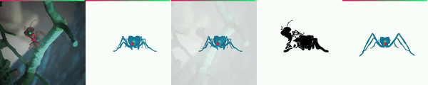

# Legacy functionality

This directory documents the **optimization-based** fitting workflow that SMILify inherited from [SMALify](https://github.com/benjiebob/SMALify). It is kept for compatibility, but fitting is now done primarily through the neural single-/multi-view pipeline — see the [root README](../README.md) and [smal_fitter/neuralSMIL/README.md](../smal_fitter/neuralSMIL/README.md). Use this path if you specifically need the gradient-descent `SMALFitter`, e.g. to fit a SMIL model to a single annotated image.

> The fitter works with any rigged SMIL model `.pkl` set as `config.SMAL_FILE`: joint names, hierarchy, root joint, `N_POSE`, `N_BETAS` and joint limits are all read from the model file. The original SMAL quadruped path (hard-coded dog skeleton, BADJA / StanfordExtra loaders, `generate_video.py`) was removed in [#110](https://github.com/FabianPlum/SMILify/issues/110); the last commit containing it is `ef17be6`.

## Installation

The optimization path uses the same conda environment as the rest of the repo — see [Installation](../README.md#installation) (`conda env create -f environment.yml`).

## QuickStart: Running the Fitter

Run on the default synthetic sample image generated with _[replicAnt](https://github.com/evo-biomech/replicAnt)_:



```
python -m smal_fitter.optimize_to_joints
```

Outputs are written to a timestamped directory `checkpoints/<YYYYMMDD-HHMMSS>/` (`config.OUTPUT_DIR`). Files named `stX_epY` mean stage X, iteration Y of the fitter; the final output is `st10_ep0`.

| Extension | Meaning |
| --- | --- |
| `.png` | Image visualization |
| `.ply` | Mesh file (view in e.g. [MeshLab](https://www.meshlab.net/)) |
| `.pkl` | Latest model/camera parameters |

## Running on alternative data

### Choosing the input image

Edit [config.py](../config.py):

| Config Setting | Explanation | Example |
| --- | --- | --- |
| `SEQUENCE_OR_IMAGE_NAME` | `replicAnt:<file name>` of an image listed in `REPLICANT_PATH/labels.json`. `replicAnt` is the only supported prefix. | `replicAnt:SMIL_09_synth.jpg` |
| `REPLICANT_PATH` | COCO-style folder: `labels.json` (keypoints named after the model's joints) plus the images under `data/`. Silhouettes are read from the replicAnt ID passes (`<name>_ID.png`) in the sibling `SMIL/` folder. | `data/replicAnt_trials/SMIL_COCO` |
| `SMAL_FILE` | The SMIL model `.pkl` to fit | `3D_model_prep/SMIL_OmniAnt.pkl` |

### Building your own deformable model

To learn a new shape space (e.g. for a species group not covered by the bundled models), register a template SMIL model to a collection of 3D meshes with [fitter_3d](../fitter_3d/) (see the [fitter_3d README](../fitter_3d/README.md)), then build the model in Blender as described under [Adding new parametric models](../README.md#adding-new-parametric-models).

## Improving performance — the loss weights (`OPT_WEIGHTS`)

`config.OPT_WEIGHTS` is a **9-row** array; each row holds one weight per optimization stage (the fitter runs in stages with different weights to avoid poor local minima — e.g. no 2D joint loss until an approximate camera is found, no silhouette loss until limbs are roughly placed). The rows are:

| Row | Component | Tips |
| --- | --- | --- |
| `Joint` | 2D keypoint reprojection | Increase if limbs don't match the input 2D keypoints after fitting. |
| `Sil Reproj` | 2D silhouette overlap | Increase if the reconstructed shape doesn't match (e.g. too thin). |
| `Betas` | 3D shape prior | Increase if reconstructions don't look animal-like. |
| `Pose` | 3D pose prior | Increase if limb configurations are implausible (legs in strange places). |
| `Joint limits` | Hinge loss on the per-joint limits authored in the model `.pkl` (`joint_limits`) | Joints left free are unconstrained; see the [Joint Limits User Guide](../docs/joint_limits_user_guide.md). |
| `Splay` | Limb-splay regularizer | |
| `Temporal` | Inter-frame smoothness (videos only) | Adjust if limbs jitter between video frames. |
| `Num iterations` | Iterations per stage | Can usually be reduced for efficiency (defaults err on the cautious side). |
| `Learning Rate` | Learning rate per stage | |

## Licencing
(C) Fabian Plum, Imperial College London & Forschungs Zentrum Juelich & scAnt UG, Department of Bioengineering, and Benjamin Biggs, Oliver Boyne, Andrew Fitzgibbon and Roberto Cipolla. Department of Engineering, University of Cambridge 2020
